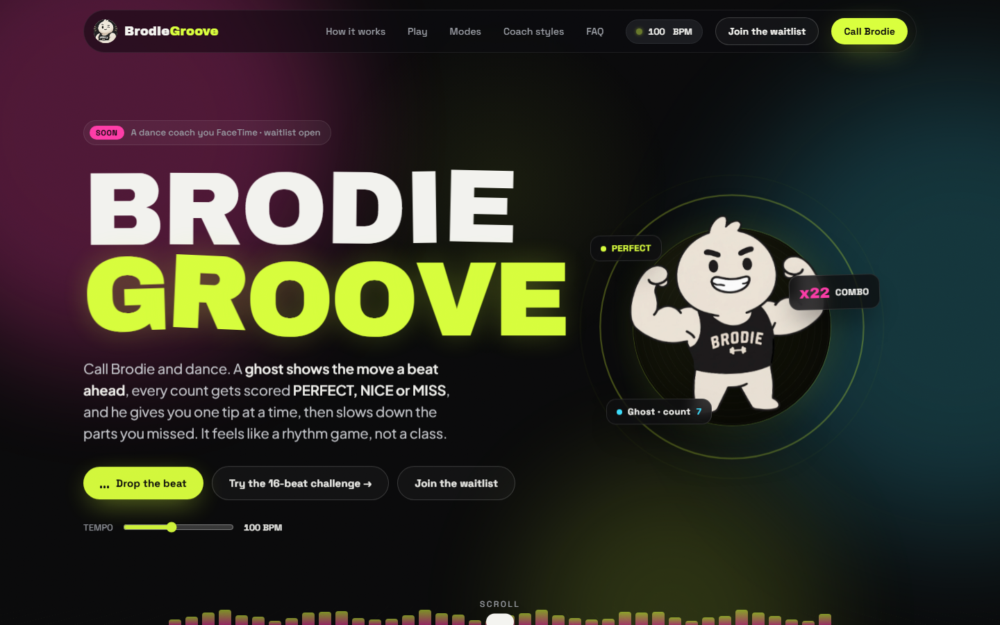
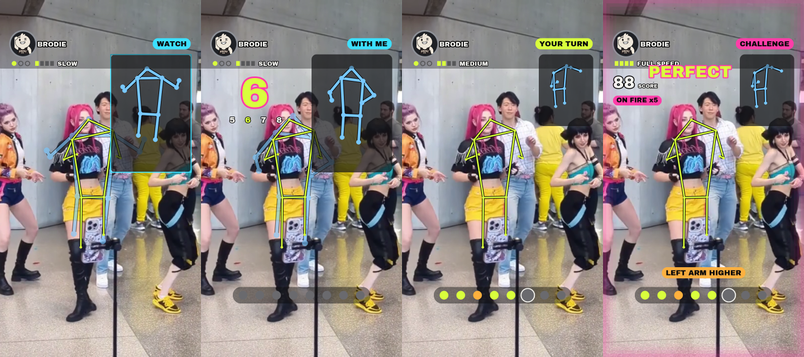
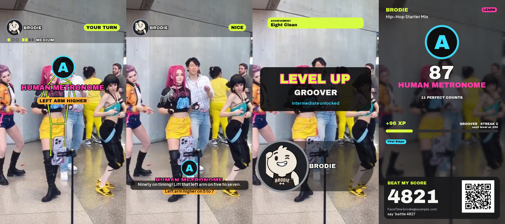
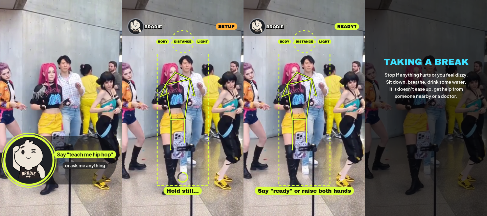
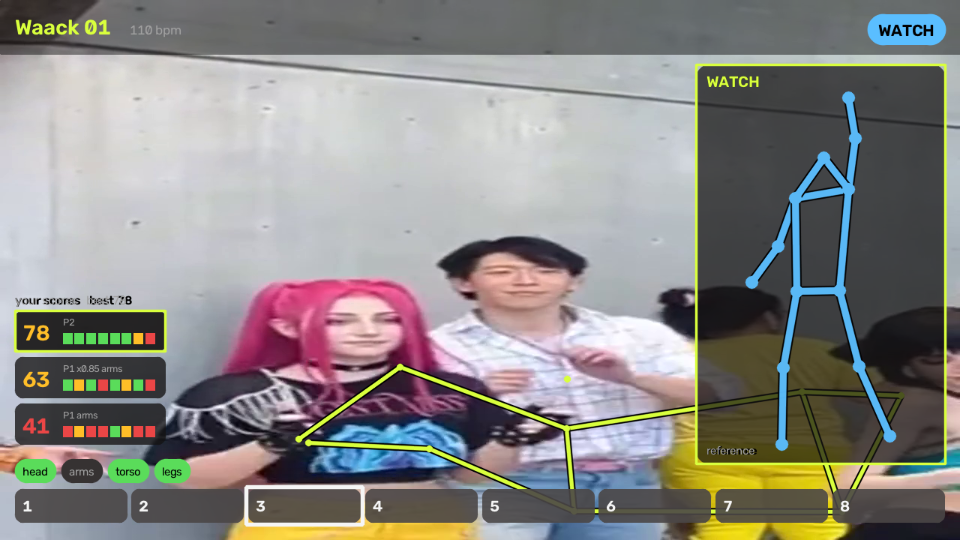
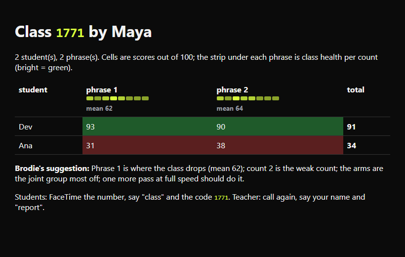
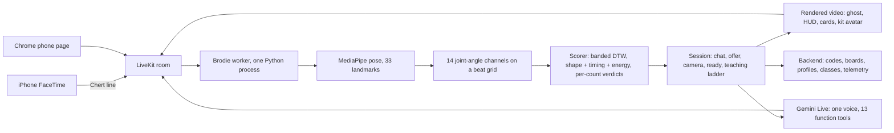

# Brodie Groove

**A dance coach you FaceTime.** Call a phone number, and Brodie watches you through the camera, shows the move as a ghost on
your own body, scores every count PERFECT / NICE / MISS, gives you one tip at a time, and slows down the parts you missed.
It plays like a rhythm game, not a class.

Built on the [Brodie starter](docs/STARTER_README.md) (Seraphim Labs) for the IvyHacks **Health x FaceTime** hackathon,
Penn, Oct 10 to 11, 2026. Team **BrodieGroove**. Everything we added lives in [`team/`](team/); the starter is untouched apart
from three small worker fixes.

[](https://brodiegroove.vercel.app/)

- **Site**: https://brodiegroove.vercel.app/
- **Waitlist**: https://forms.gle/dZ7rSLHjGAEncSzc8
- **Call it**: a FaceTime video call to the hackathon's shared Chert line during one of our booked slots (the address is on
  the site when a slot is live). No app, no account, no install: a phone number is the whole onboarding.
- **Try it in Chrome** without an iPhone: see [Run it](#run-it) below.

## What a call looks like

1. **Hello.** Brodie asks your name and what you are into, suggests a routine for your level, and waits for your yes.
2. **Camera check.** He gets your head and hips into frame, one issue at a time ("step back a little"), asks if you have
   space, then waits for "ready" or both hands up.
3. **Watch.** The move plays slowly as a ghost on your body and in a corner panel, with a 5-6-7-8 count-in.
4. **With me, then your turn.** You dance it with the ghost, then alone. Every count gets a verdict; combos light up; one
   specific tip ("lift your left arm higher on counts 5 to 7").
5. **Adapt.** Two misses and he breaks the step down (slower, arms first); a pass and a yes and the speed goes up one notch.
   Steps are then put together into the routine.
6. **Scorecard.** Grade, title ("Human Metronome"), XP and level, a four-digit challenge code and a QR that opens FaceTime
   to the line, so a friend can duel your score from a screenshot.







Laptop webcams work too: the canvas follows the camera, and if only your upper body is in view the arms get scored.



## Modes

| Mode | What happens | Social hook |
|---|---|---|
| **Learn** | One step at a time, then the steps together; adapts speed and breaks steps down | Scorecard with code and QR |
| **Ghost Battle** | Three rounds against the reference (two phrases plus a freestyle groove round), HP bar, K.O. | Four-digit duel code; a friend who says it hears the verdict on their own call |
| **Daily Challenge** | The same routine for everyone today | Daily board |
| **Squad Battle** | Two to four friends in one camera, tagged by colour, Crew Sync and MVP | Crew board per code |
| **Dance Telephone** | Copy the previous dancer's move, pass a code on; the move mutates | Drift page per chain |
| **Class** | A teacher records phrases to a count-in; students join by code; the teacher's next call opens with the class report | Heatmap page: students by phrase, weak counts |



Coach styles (hype, chill, coach), XP, levels, unlocks, achievements and a profile per spoken first name. Safety stop on pain
words; "forget me" twice deletes everything about you.

## How it works



- **Keys** are reference performances as feature samples on a beat grid, built from a video (MediaPipe offline, beat grid from
  librosa or a fixed BPM) or from motion data. Library: AIST++ basic moves (research terms, demo only), two Creative Commons
  clips, and routines generated per style and level by stitching phrases ranked by motion complexity.
- **Scoring**: a banded dynamic time warp aligns attempt and key; shape error on the aligned pairs, timing offsets from the warp
  path (credit only when the shape is roughly right), hip-energy envelope. Per-count verdicts, combos, grade and title.
- **Feedback** turns signed joint errors into one directional cue with a side, a body part and the counts.
- **Session**: a state machine (chat, offer, camera setup, ready check, routine, review) with error boundaries; nothing
  starts without the caller's yes. Gemini speaks through one queue; the regex command parser is the fallback for the tools.
- **Video**: the caller's own frame with the live skeleton, the ghost on the body and in a panel, real type, PERFECT / NICE /
  MISS pops, the beat timeline, result reveals, the end scorecard with a QR. Portrait for FaceTime, landscape for a laptop.
- **Group play**: multi-person pose with a primary-dancer lock (walk-ins never steal the scoring) and per-colour engines on one
  music clock for squads.

## The codebase

```
team/
  dance/            the skill
    features.py       landmarks -> 14 angle channels, visibility, hip energy, beat-grid resampling
    reference.py      video or motion data -> key JSON (beat grid, phrases, ghost skeleton, provenance)
    ingest.py, ingest_aist.py   COCO/AIST++ 3D keypoints -> keys
    choreo.py         routines by style and difficulty from the library; deterministic names; daily challenge
    scoring.py        banded DTW, shape/timing/energy, per-count verdicts, combo
    engine.py         show, count-in, attempt, scored, feedback; lag compensation; live verdicts
    feedback.py       directional cues ("lift your left arm higher on counts 5 to 7"), mid-phrase tips
    setup.py          camera setup from what the pose can verify (in view, head to hips, distance, light)
    live.py           the session inside the worker: chat, offer, setup, ready, teaching ladder, modes, simulator
    tools.py          Gemini function tools backed by the analysis code
    render.py, text.py, fx.py, avatar.py   the video: HUD, cards, effects, kit avatar, real fonts
    multipose.py, squad.py                 several dancers in one camera
    gestures.py       hands up = ready, arms crossed = pause
    progression.py    grades, titles, XP, levels, unlocks, achievements
    telemetry.py      per-session JSONL, metrics
    audio.py          metronome, count-in, sound effects
    tests/, eval/     53 tests; scripted end-to-end sessions; HUD snapshots
  backend/          FastAPI + Postgres (Supabase; SQLite for tests): results and codes, duels, chains, classes, profiles, boards, share funnel, metrics, /join
  cloud/            the always-on box: worker + backend in one container on Railway, no Docker (README.md there is the runbook)
  web/              phone.html (any browser as the caller), groove/ (the landing page)
  scripts/          one-command runners: chrome.ps1, dance_loop.ps1, chert.ps1 (Chert CLI on Windows), mint_link.py, chrome_test.py
  CHROME_TEST_GUIDE.md   how to test from Chrome on a laptop or Android, and on the Chert line
facetime/           the starter's worker (unchanged except: Windows signal guard, a Gemini instruction prefix, per-call recordings)
```

## Run it

```
uv venv --python 3.12 .venv && uv pip install -r requirements.txt      # Windows: see team/PROGRESS.md for the venv note
copy .env.example .env.local                                            # LiveKit URL/key/secret, Gemini team token and relay
.\team\scripts\chrome.ps1 -Demo        # starts the worker and the https page server, mints a room, opens Chrome
```

Open the link, allow camera and mic, tap Join. `-Demo` skips the chat gates and goes straight from the camera check into one
routine; without it the full flow runs. To run it in the cloud instead (Supabase for the database, Railway for the worker and
the backend, nothing on a laptop) follow [`team/cloud/README.md`](team/cloud/README.md); `https://<your box>/join` then
opens the same browser caller for anyone. The repo ships the Creative Commons keys; the AIST++ basic-move keys the generated
routines draw on are not redistributed (research terms): download `keypoints3d.zip` from the AIST++ release into `data/aist/`
and run `python -m team.dance.ingest_aist` once (about a minute). `python -m team.dance.live --simulate clip.mp4 --mode learn --lobby --say "3:I'm Maya"
--say "9:teach me hip hop" --say "20:ready"` runs the same code without LiveKit and writes what the caller would have seen.
`python -m pytest team/dance/tests` runs the tests. The Chert line: `team/CHROME_TEST_GUIDE.md`, last section.

## What we built on top of the starter

The starter is a real-time rep-counting coach with a licensed exercise classifier. We turned off its perception and built a
dance skill with its own: a reference library and ingesters, a beat-grid scorer, a phrase engine, a rendered video track
(the starter publishes audio only), a session state machine driven by Gemini with function tools, six modes, a game layer,
a backend with codes and boards, a landing page, any-browser testing, and the Chert CLI running on Windows.

## Honest limits

- The scorer separates "same move, different camera" from noise by only 10 to 15 points on cropped webcam views; the fix
  (start-offset search, beat-clock timing, camera-tilt normalisation) is next.
- No real-person call has landed on the Chert line yet; everything was verified in the simulator, headless Chrome and
  Chrome with a person. Chert lists Windows as unsupported; our wrapper gets the CLI to a held line.
- Squad tags follow position and can swap when dancers cross. The backend has no auth; identity is the first name you say.

## Credits and licences

- Brodie starter, character kit and the Chert line: Seraphim Labs (Brodie) and Chert. Only kit art is used for Brodie's face.
- MediaPipe Pose Landmarker (Google, Apache 2.0). LiveKit (Apache 2.0). Gemini Live through the organisers' relay.
- AIST++ keypoints (Li et al. 2021; AIST Dance Video DB terms): research use, never redistributed, not in this repo.
- Clips for keys and the screenshots above: "ANYC25 from YouTube video by TBC - Huntrix cosplay dance" by The Cosplay Baker,
  Wikimedia Commons, CC BY 4.0; "PM plus size dancer" by Warmglow, CC BY-SA 4.0.
- Fonts: Archivo Black, Plus Jakarta Sans, Space Grotesk (SIL OFL). QR codes: segno (BSD).

Team BrodieGroove, IvyHacks 2026.
